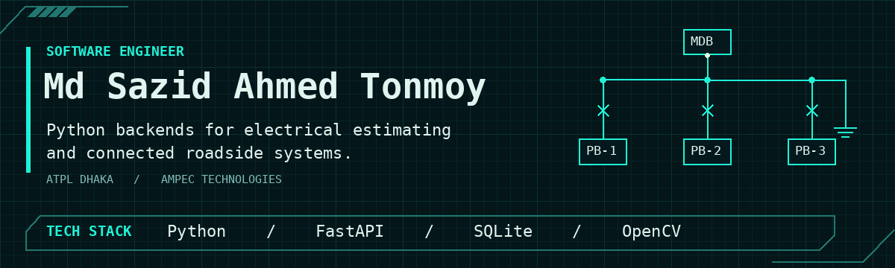
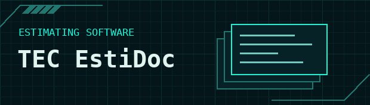
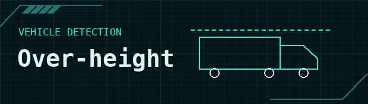

[**Portfolio ↗**](https://sazidahmedtonmoy.github.io/)　 /　 [LinkedIn](https://www.linkedin.com/in/sazidahmedtonmoy/)　 /　 [Email](mailto:sanzidtonmoy@gmail.com)

I build Python backends for electrical estimating teams and software for roadside controllers. My work ranges from pricing a bill of materials to matching a LiDAR detection with the camera frame that explains it.

## Selected work

<table>
<tr>
<td width="50%" valign="top">
Electrical estimators price materials and labour from a shared catalogue. Tender teams track each builder’s submission and follow-up.

<strong>4,029</strong> active catalogue items · <strong>41</strong> estimates · <strong>408</strong> builder submissions
Release 3.8.0 · 18 November 2026 snapshot
<a href="https://sazidahmedtonmoy.github.io/#projects">Explore the database diagram ↗</a>
</td>
<td width="50%" valign="top">
LiDAR measures vehicle height. The controller pairs each event with a camera frame, isolates the vehicle with YOLO and displays its silhouette on a roadside LED sign.

NVIDIA Jetson · LiDAR · YOLO · Colorlight LED
</td>
</tr>
</table>

<strong>Four more field systems</strong> · roadside control and traffic monitoring

- **School Zone Alert Sign System** — a Raspberry Pi validates timetables, switches warning lanterns and reports battery voltage and LED current.
- **Advanced Warning System** — a single controller handles radar, radio, wired and off-road modes, with local flash tests and fault logs.
- **Crowd Management System** — directional camera counts track occupancy and activate a digital output when the configured threshold is reached.
- **Vehicle Counting System** — camera events are grouped by lane and vehicle class, producing rolling counts and configurable output pulses.

## Experience

**Software Engineer · ATPL Dhaka**  
*February 2024 – present*  
Python services and operator dashboards for estimating teams and roadside equipment. My work also covers Excel and PDF automation, sensor integration and field diagnostics.

**R&D Engineer · Shanghai BDCOM InfoTech**  
*March – December 2023*  
I wrote a TFTP server in embedded C for the S2510-P switch on VxWorks, including option negotiation and block-size extensions. [View the networking project ↗](https://github.com/SazidAhmedTonmoy/Professional-Project)

## Toolkit

**Python · FastAPI · Flask · SQLite · MySQL**  
My main tools for building APIs, modelling project data and connecting web interfaces to field devices.

Explore the full toolkit

| Area | Tools and interfaces |
| --- | --- |
| **Backend & databases** | Python, FastAPI, Flask, REST APIs, SQLite, MySQL |
| **Edge AI & computer vision** | OpenCV, YOLO, PyTorch, TensorFlow, scikit-learn |
| **Embedded systems** | C, C++, Embedded Linux, VxWorks, Raspberry Pi, NVIDIA Jetson, GPIO, UART |
| **IoT & connectivity** | TCP/IP, UDP, MQTT, LoRa, LoRaWAN, AWS IoT Core |
| **Data & automation** | pandas, NumPy, openpyxl, Bash, Gemini API |
| **Web interfaces & delivery** | JavaScript, HTML, CSS, Git, Docker, Postman |

## Education

**North South University** · BS in Computer Engineering · January 2019 – November 2022  
**Cum Laude · CGPA 3.52**  
I specialized in artificial intelligence, minored in computer networks and participated in problem-solving and Kaggle competitions.

<strong>Undergraduate research and software projects</strong>

- **Tooth decay detection** — used YOLOv6 and OpenCV to locate decay in dental images.
- **Ocular disease recognition** — built a ResNet50 classifier with a Streamlit interface for cataracts, glaucoma and myopia.
- **Chest X-ray classification** — applied MobileNetV2 transfer learning to a dataset of 5,000 images for pneumonia and COVID-19 classification.
- **Heart disease and diabetes prediction** — explored clinical datasets and compared supervised classifiers with scikit-learn.
- **NSU Internship Management System** — built application, evaluation and advisor-reporting workflows with PHP, MySQL and JavaScript.
- **Formula_Pro and Vivid Letter** — developed Python and Jupyter utilities for engineering calculations and document formatting.

[Browse my university projects ↗](https://github.com/SazidAhmedTonmoy/Projects)

